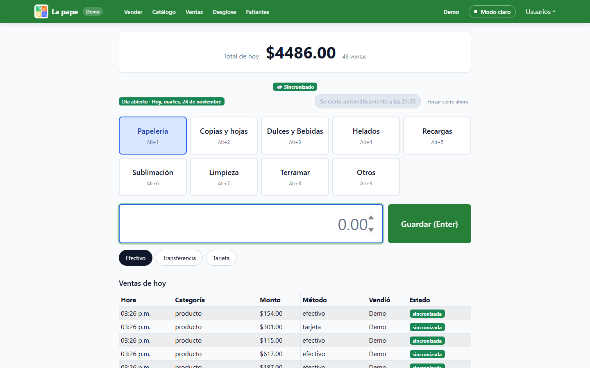
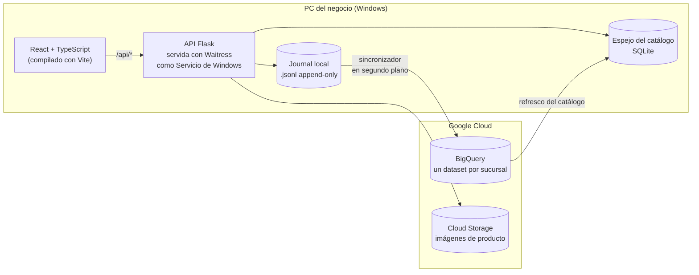
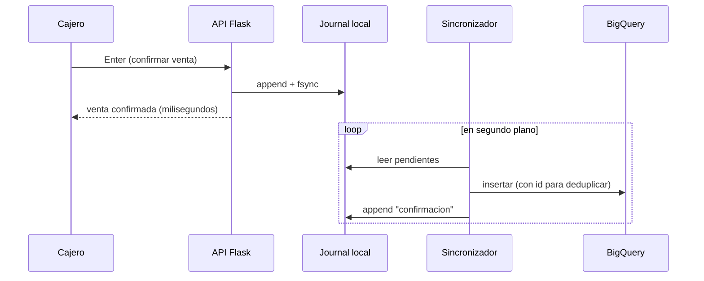

# La Papelería — Punto de venta para papelerías

Sistema de punto de venta, catálogo e inventario que **opera todos los días en
dos sucursales reales** de una papelería. Lo diseñé, desarrollé y mantengo de
punta a punta: frontend, backend, datos en la nube, instalador para las PCs del
negocio y el flujo de trabajo con especificaciones.

> Este repositorio es una copia pública y curada del repo privado de trabajo.
> Se regenera con un script de exportación que filtra rutas, limpia valores
> privados y escanea secretos antes de publicar.


<!-- Capturas: agregar en docs/ con datos ficticios

-->

## Qué hace

| Área | Funcionalidad |
|---|---|
| **Punto de venta** | Captura de ventas con lector de código de barras o búsqueda, cancelación y edición de ventas, registro del vendedor |
| **Catálogo** | Alta y edición de productos, escaneo, categorías, imágenes (convertidas a WebP y guardadas en Cloud Storage) |
| **Cierre de día** | Acta de cierre automática a la hora configurada, regenerable, con gastos del día |
| **Reportes** | Desglose del día por categoría, agregaciones de ventas, panel anual |
| **Operación** | Compras de trabajadores, lista de faltantes, usuarios con roles y foto de perfil |
| **Sucursales** | Cada sucursal tiene su propia base de datos; el backend se niega a arrancar si no sabe cuál es la suya |

## Arquitectura



- Un solo proceso sirve la API y el frontend compilado en el mismo origen, así
  que en producción no hace falta CORS.
- El backend arranca en modo producción por defecto; el modo desarrollo hay
  que pedirlo explícitamente (`ENTORNO=desarrollo`).
- Secretos y credenciales solo por variables de entorno (`backend/.env`). Si
  falta el `JWT_SECRET_KEY` en producción, el proceso no arranca.

## Decisión clave: primero local, después la nube

El internet del local no es confiable, y una venta no puede esperar a BigQuery.
Por eso **cada venta se confirma escribiéndola en disco local** y se sube a la
nube después:



- El journal es **append-only**: nunca se reescribe una línea. El estado
  (`pendiente` / `enviada`) se calcula al leer, no se guarda como campo mutable.
- Los inserts a BigQuery llevan el id de la venta para deduplicar, así que
  reintentar tras un corte no duplica ventas.
- El catálogo se consulta desde un **espejo en SQLite**, por lo que buscar
  productos tampoco depende de la red.
- Las pantallas del día en curso leen del journal, no de BigQuery.

## Varias sucursales

Cada papelería usa su propio dataset de BigQuery (`BQ_DATASET`). El backend
exige esa variable en producción para que nunca se guarden las ventas de una
sucursal en la base de otra, y el login valida que el usuario pertenezca a esa
sucursal. Un script (no incluido en esta copia) genera el paquete de instalación de cada sucursal nueva.

## Pruebas

```
backend/tests/   ~45 archivos · más de 500 casos · pytest
```

- Pruebas unitarias y de endpoints con clientes de BigQuery falsos, sin red.
- **Aislamiento del disco real:** cada test corre contra su propia carpeta
  temporal, y además hay una red de seguridad que hace fallar de inmediato
  cualquier escritura que llegue a resolver la ruta real de datos.
- El reloj se inyecta (`ahora=`) para probar cierres de día y zonas horarias
  sin depender de la hora real.

## Cómo trabajo: desarrollo guiado por especificaciones

Cada cambio pasa por [OpenSpec](https://github.com/Fission-AI/OpenSpec):
propuesta → diseño → specs con escenarios → tareas → implementación → archivo.

- [`openspec/specs/`](openspec/specs/) — especificaciones vigentes del sistema
  (requisitos con escenarios WHEN/THEN).
- [`openspec/changes/archive/`](openspec/changes/archive/) — una selección de
  cambios ya terminados, con su propuesta y diseño. Ejemplos:
  - [Espejo local del catálogo en SQLite](openspec/changes/archive/2026-09-09-espejo-local-catalogo-sqlite/)
  - [Acta de cierre de día regenerable](openspec/changes/archive/2026-09-02-cerrar-dia-acta-regenerable/)
  - [Sacar el secreto JWT del código](openspec/changes/archive/2026-09-09-mover-jwt-secret-a-env/)

## Estructura

```
├── backend/
│   ├── main.py              # app Flask, configuración, arranque
│   ├── acceso_datos/        # cliente y repositorios de BigQuery
│   ├── almacen_local/       # journal, espejo SQLite, sincronizador, cierres
│   ├── autentificacion/     # login, JWT, bcrypt, credenciales de GCP
│   ├── catalogos/           # productos e imágenes
│   ├── ventas/              # capturas, cancelaciones, ediciones, cierres
│   ├── reportes/            # agregaciones y dashboard
│   ├── compras/ faltantes/ usuarios/
│   ├── esquema/             # creación de tablas y migraciones
│   ├── servicio_windows.py  # arranque como Servicio de Windows
│   └── tests/
├── frontend/
│   └── src/                 # páginas, componentes, servicios, sistema de diseño
├── openspec/                # specs y cambios archivados
└── scripts/                 # build, arranque e instalación del servicio
```

## Cómo correrlo

> Necesitas un proyecto propio de Google Cloud con BigQuery y un bucket de
> Cloud Storage, y una cuenta de servicio con acceso a ambos. Las variables
> están documentadas en [`backend/.env.example`](backend/.env.example). Un modo
> demo sin GCP está en los próximos pasos.

**Backend** (Windows, Python 3.11 o más reciente; probado con 3.14):

```powershell
cd backend
python -m venv venv
.\venv\Scripts\Activate.ps1
pip install -r requirements.txt
copy .env.example .env    # y llénalo
python -m esquema.crear_dataset
$env:ENTORNO = "desarrollo"; python main.py
```

**Frontend:**

```powershell
cd frontend
npm install
npm run dev    # :5173, reenvía /api/* a Flask en :5000
```

**Pruebas:**

```powershell
cd backend
.\venv\Scripts\python.exe -m pytest
```

**Producción:** `scripts\build.ps1` compila el frontend y Waitress sirve todo
desde un solo proceso; `scripts\instalar_servicio.ps1` lo instala como
Servicio de Windows con arranque automático.

## Próximos pasos

- Modo demo con datos ficticios que no necesite Google Cloud.
- Capturas de pantalla en este README.

## Autor

**Jonathan Castellanos Hernández** — [github.com/JohnCaste](https://github.com/JohnCaste)
